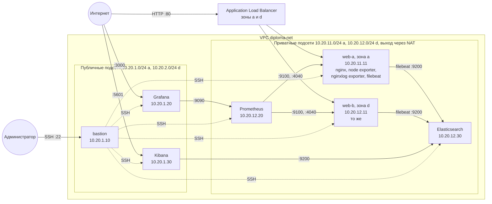
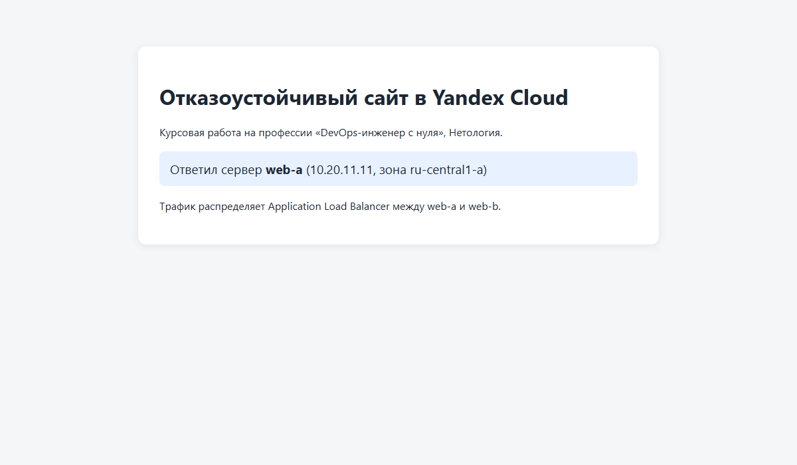
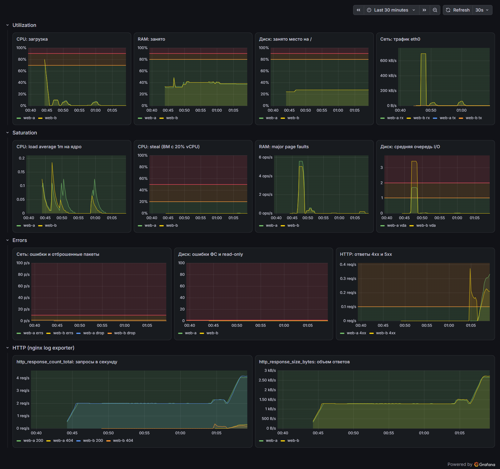
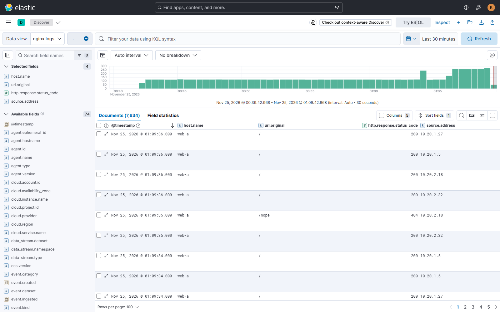

# Курсовая работа «DevOps-инженер с нуля»: отказоустойчивый сайт в Yandex Cloud

Выполнил: Павел Логачев. Условие задания: [netology-code/fops-sysadm-diplom](https://github.com/netology-code/fops-sysadm-diplom/blob/main/README.md), вариант с Prometheus.

Всю инфраструктуру создает Terraform, а все сервисы настраивает Ansible. Руками в консоли облака ничего не делалось. Стенд развернут и проверен 24–25 ноября 2026 года.

## Доступ

| Ресурс | Адрес | Вход |
|---|---|---|
| Сайт (через Application Load Balancer) | http://62.84.117.222/ | без пароля |
| Grafana, дашборд «Веб-серверы: USE и HTTP» | http://84.201.135.19:3000/d/diploma-web/ | анонимный просмотр (роль Viewer) |
| Kibana, логи nginx | http://51.250.90.27:5601/ | кнопка «Continue as Guest» (только чтение) |

Стенд учебный и платный, поэтому после проверки его удаляют (см. «Удаление стенда»). Если ссылки не открываются, смотрите скриншоты и выводы команд в [`evidence/`](evidence/).

## Схема



## Что сделано по пунктам задания

### Сайт

- Две одинаковые ВМ `web-a` (зона `ru-central1-a`) и `web-b` (`ru-central1-d`) на Ubuntu 24.04 с nginx. На них лежит статичная страница, которая показывает, какой сервер ответил ([`index.html.j2`](ansible/templates/index.html.j2)).
- [`terraform/alb.tf`](terraform/alb.tf) по порядку создает Target Group с обеими ВМ, Backend Group с проверкой состояния HTTP `/` на порт 80, HTTP router с маршрутом `/` и Application Load Balancer. Балансировщик размещен в двух зонах, слушатель работает на порту 80, публичный адрес выделяется автоматически.
- Проверка `curl -v http://62.84.117.222:80` показала `HTTP/1.1 200 OK` с `server: ycalb` ([`evidence/curl-alb.txt`](evidence/curl-alb.txt)). Ответы делятся между серверами примерно поровну:

| web-a | web-b |
|---|---|
|  |  |

**Проверка отказа** ([`evidence/failover.txt`](evidence/failover.txt)). Если остановить nginx на web-a, через 30 секунд балансировщик помечает его `UNHEALTHY`, и все 20 из 20 запросов получают `200` от web-b. После запуска nginx нагрузка снова делится 10/10.

При первом прогоне у Backend Group стоял `panic_threshold = 90`, и 9 из 20 запросов получили `503` ([`evidence/failover-panic90.txt`](evidence/failover-panic90.txt)). Когда исправна только половина серверов, это ниже порога 90 %. Балансировщик тогда переходит в режим паники и шлет запросы на все серверы, в том числе на упавший. Я поставил `panic_threshold = 0`: для двух серверов режим паники только мешает.

### Мониторинг

- На веб-серверах стоят Node Exporter (`prometheus-node-exporter` из Ubuntu) и [Nginx Log Exporter](https://github.com/martin-helmich/prometheus-nginxlog-exporter) 1.11.0. Экспортер разбирает `access.log` в формате `combined` и отдает метрики `nginx_http_response_count_total` и `nginx_http_response_size_bytes` с метками `host`, `method` и `status`.
- Prometheus (ВМ `prometheus`, приватная подсеть) собирает метрики со всех экспортеров. Все цели в состоянии `up` ([`evidence/prometheus.txt`](evidence/prometheus.txt)).
- Grafana 13.3.2 на отдельной ВМ. Источник данных и дашборд подключаются через provisioning. Дашборд генерирует скрипт [`scripts/make_dashboard.py`](scripts/make_dashboard.py), результат лежит в [`web-dashboard.json`](ansible/files/web-dashboard.json). На каждом графике пороги показаны линиями и цветными областями (зеленая, оранжевая, красная).

| Раздел | Панели и пороги |
|---|---|
| Utilization | CPU % (70/90), RAM % (80/90), место на диске / (80/90), трафик eth0 (10/50 МБ/с) |
| Saturation | load average на ядро (1/2), CPU steal % (20/50), major page faults (50/200), очередь I/O диска (1/2) |
| Errors | ошибки и отброшенные пакеты сети (1/10), ошибки ФС и read-only (1), ответы HTTP 4xx и 5xx (0,1/1 в секунду) |
| HTTP | `http_response_count_total` по серверам и статусам, `http_response_size_bytes` по серверам |



### Логи

- Elasticsearch 8.19.26 работает одним узлом на ВМ `elastic` в приватной подсети. Пароли включены, TLS выключен, компромисс описан ниже. Без пароля API отвечает `401` ([`evidence/elasticsearch.txt`](evidence/elasticsearch.txt)).
- На веб-серверах стоит Filebeat 8.19.26 с модулем `nginx`. Он отправляет `access.log` и `error.log` под отдельным пользователем `filebeat`, роль которого разрешает только запись в `filebeat-*`. В индексе `filebeat-*` больше 11 тысяч документов с обоих серверов: `event.dataset` равен `nginx.access` и `nginx.error`.
- Kibana 8.19.26 подключена к Elasticsearch под служебным пользователем `kibana_system`. Представление данных «nginx logs» (`filebeat-*`) создается через API в playbook. Гостевой вход дает пользователя `kibana_viewer` со встроенной ролью `viewer`: он только читает.



### Сеть

Одна VPC `diploma-net` с четырьмя подсетями. Приватные подсети выходят в интернет через NAT-шлюз, чтобы ставить пакеты. Входящие соединения разрешены только на нужные порты:

| Группа | Входящий трафик |
|---|---|
| `diploma-bastion` | 22 из интернета |
| `diploma-internal` (у всех ВМ, кроме bastion) | 22 только из группы `diploma-bastion` |
| `diploma-alb` | 80 из интернета; 30080 от проверок состояния ALB |
| `diploma-web` | 80 из группы `diploma-alb` и от проверок ALB; 9100 и 4040 только с Prometheus |
| `diploma-prometheus` | 9090 только с Grafana |
| `diploma-elastic` | 9200 только с web-a, web-b и Kibana |
| `diploma-grafana` | 3000 из интернета |
| `diploma-kibana` | 5601 из интернета |

Публичные адреса есть только у bastion, Grafana, Kibana и балансировщика. Все ВМ доступны по SSH только через bastion (`ProxyCommand` в инвентаре Ansible, который генерирует [`inventory.yml.tftpl`](terraform/inventory.yml.tftpl)). Вход везде только по ключу, пароли SSH отключены в [cloud-init](terraform/cloud-init.yaml.tftpl).

### Резервное копирование

[`terraform/snapshots.tf`](terraform/snapshots.tf) создает расписание `diploma-daily`: снимок загрузочных дисков всех 7 ВМ каждый день в 00:00 UTC (03:00 МСК), каждый снимок хранится 7 дней (`retention_period` 168 часов). Чтобы проверить расписание, не дожидаясь ночи, я временно сдвинул его время на ближайшие минуты. Расписание создало 7 снимков в статусе `READY`, после этого `terraform apply` вернул время 00:00 ([`evidence/snapshots.txt`](evidence/snapshots.txt)).

## Решения и компромиссы

- **Прерываемые ВМ и неполная доля vCPU (20 %, у Elasticsearch и Kibana 50 %).** Для учебного стенда это в несколько раз дешевле. Минус в том, что облако может остановить такую ВМ, не реже чем раз в сутки. Внутренние адреса фиксированы, поэтому после `yc compute instance start <имя>` все связи восстанавливаются без перенастройки. Для настоящего сайта нужно поставить `preemptible = false` (переменная в [`variables.tf`](terraform/variables.tf)).
- **Elasticsearch без TLS.** Пакет 8.x сам включает TLS с самоподписанным сертификатом. Тогда каждому клиенту нужен сертификат CA, а Kibana получает адрес через enrollment token. Я оставил аутентификацию и отдельных пользователей с минимальными правами, а TLS выключил: порт 9200 закрыт группой безопасности и доступен только трем ВМ внутри VPC. В продакшене TLS надо включить.
- **Elasticsearch на одном узле**, поэтому статус кластера `yellow`: реплику шарда некуда положить. Отказоустойчивый кластер логов требует еще минимум двух ВМ, задание этого не требует.
- **Пакеты Elastic ставятся с зеркала `mirror.yandex.ru/mirrors/elastic/8`.** Подпись проверяется официальным ключом Elastic, он лежит в [`ansible/files/elastic.asc`](ansible/files/elastic.asc). Grafana ставится из пакета с `dl.grafana.com`. Если сайт недоступен с ВМ, playbook скачивает пакет на машину управления и копирует его на ВМ.
- **Публичный доступ к Grafana и Kibana** нужен по условию сдачи. В обоих анонимный пользователь только читает. Администраторские пароли хранятся в `.secrets/passwords.yml`, который не попадает в Git.
- **SSH на bastion открыт для всего интернета.** Так надежнее, чем привязка к одному адресу: домашний адрес меняется. Вход только по ключу, root и пароли отключены.
- **Ansible запускается в контейнере** ([`ansible/Dockerfile`](ansible/Dockerfile)), потому что на Windows нет нативного Ansible. Используются только модули `ansible.builtin`, внешних коллекций нет.
- **Квоты.** У облака по умолчанию было по 2 vCPU и 20 ГБ HDD на зону. Для стенда я запросил 8 vCPU и 60 ГБ в зонах a и d (`yc quota-manager quota-request create`), заявки одобрили автоматически.

## Как развернуть

Нужны: `yc` с доступом к каталогу, Terraform ≥ 1.5, Docker.

```bash
scripts/init-secrets.sh                      # временный SSH-ключ и пароли в .secrets/ (не в Git)

export YC_TOKEN=$(yc iam create-token) YC_CLOUD_ID=$(yc config get cloud-id) YC_FOLDER_ID=$(yc config get folder-id)
terraform -chdir=terraform init
terraform -chdir=terraform apply             # 29 ресурсов, ~8 минут (дольше всего создается ALB)

python scripts/make_dashboard.py             # если меняли дашборд
scripts/ansible.sh                           # ~15 минут; повторный запуск ничего не меняет
```

Terraform сам пишет `ansible/inventory.yml` с адресом bastion. Если прямой SSH до облака не проходит (у меня из дома SSH-сессии к Yandex Cloud зависали), можно пробросить порт bastion через любой доступный хост, например `ssh -L 2222:<bastion_ip>:22 <host>`, и передать скрипту копию инвентаря с `ansible_host: host.docker.internal`, `ansible_port: 2222`: `INVENTORY=inventory.tunnel.yml scripts/ansible.sh`.

## Удаление стенда

```bash
terraform -chdir=terraform destroy
# снимки, созданные расписанием, Terraform не удаляет — удалить вручную:
yc compute snapshot list --format json | jq -r '.[] | select(.labels.project=="netology-diploma") | .id' | xargs -r -n1 yc compute snapshot delete
```

## Структура

```
terraform/   VPC, подсети, NAT, группы безопасности, 7 ВМ, ALB, расписание снимков, генерация инвентаря
ansible/     site.yml (все роли по порядку), шаблоны конфигураций, дашборд Grafana, Dockerfile контроллера
scripts/     init-secrets.sh, ansible.sh (запуск в контейнере), make_dashboard.py
evidence/    скриншоты и выводы команд проверки
```
